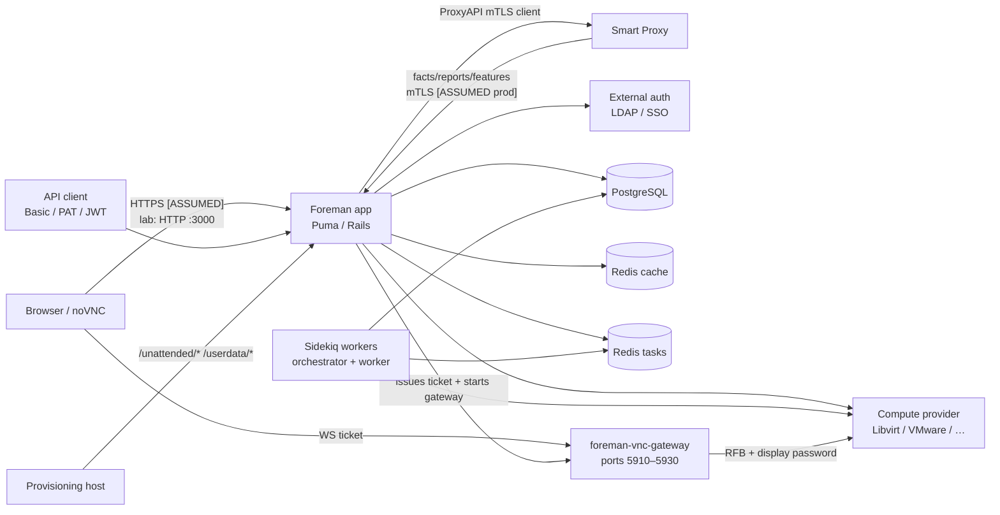
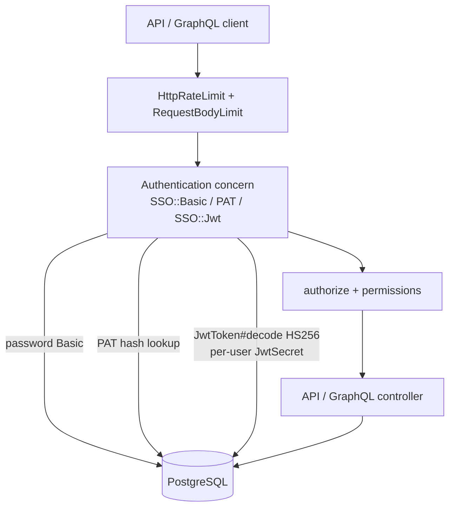
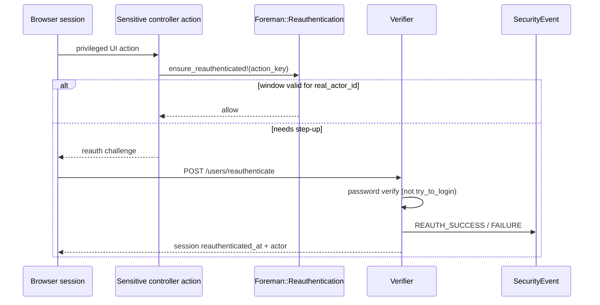
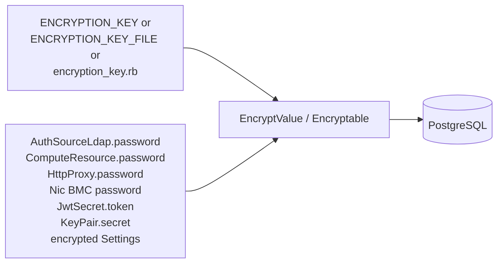
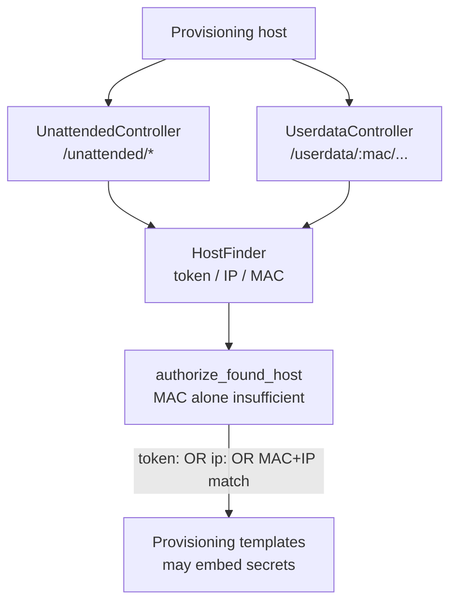
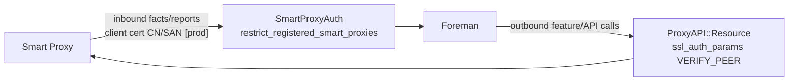
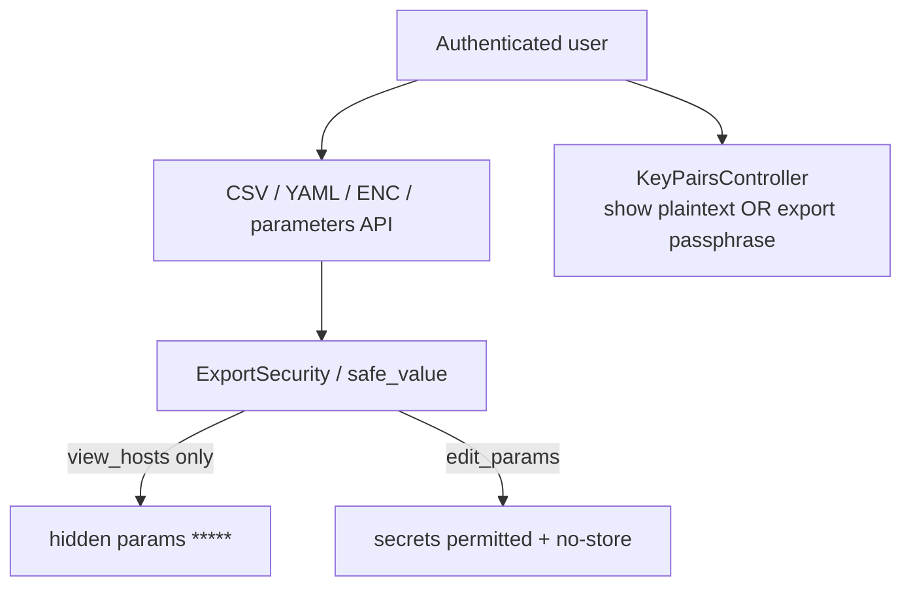

# Foreman 5.0 — Data Flow Diagrams (F-034)

Evidence baseline: branch `security-hardening-5.0`, HEAD at document
version history. Diagrams reflect **source-verified** components. Items marked
**[ASSUMED]** are common production practices not present in the local Compose
lab (`docker-compose.yml`).

Related: [threat-model.md](../threat-model.md).

## 1. System context



## 2. Interactive browser authentication and session

```mermaid
sequenceDiagram
  participant B as Browser
  participant M as Rack middleware<br/>method / body / rate
  participant U as UsersController
  participant Auth as User.try_to_login<br/>AuthSource
  participant S as sessions table<br/>EncryptedMarshal
  participant SE as SecurityEvent / Audit

  B->>M: POST /users/login
  M->>U: (if under limits)
  U->>U: CAPTCHA + BruteforceProtection + lockout
  U->>Auth: verify credentials
  alt success
    Auth-->>U: User
    U->>S: claim has_active_session; delete other rows (F-016)
    U->>S: write ARSESS1 encrypted payload (F-015)
    U->>SE: login Audit / login_events (F-001/F-002)
    U-->>B: Set-Cookie _session_id
  else failure
    U->>SE: failed_login
    U-->>B: error (no session claim)
  end
```

## 3. API / PAT / JWT authentication



Trust notes:

- `JwtToken#decode` verifies with `algorithm: 'HS256'` only (`app/services/jwt_token.rb`).
- `decoded_payload` is **inspection-only** (unsigned) to locate `user_id` before verify.
- API sets `session[:api_authenticated_session]`; reauth and browser session
  policy do not apply to token API sessions.

## 4. Reauthentication (step-up)



Action keys include user admin changes, PAT create/revoke, JWT invalidate,
SSH keys, registration commands, key-pair download, and console open
(`app/services/foreman/reauthentication.rb`).

## 5. Secret encryption at rest



Fail-closed on missing key / encrypt error for **new writes** (F-004/F-005).
Session payloads use a **separate** key derived from `secret_key_base` (F-015).

## 6. Provisioning / userdata



## 7. Smart Proxy



When `require_ssl` is false (lab default), inbound matching may use reverse DNS /
IP against registered proxy hosts and `trusted_hosts` — **not** cryptographic
authentication. Prefer mTLS in production.

## 8. VNC console (F-025)

```mermaid
sequenceDiagram
  participant U as Authorized user
  participant F as Foreman UI
  participant CR as ComputeResource.console
  participant T as Console::Ticket file
  participant G as foreman-vnc-gateway
  participant H as Hypervisor VNC
  participant B as Browser noVNC

  U->>F: Console (permission + optional reauth)
  F->>CR: generate display password; update_display
  F->>T: store password + target + TTL (mode 0600)
  F->>G: start on 5910–5930, rfb_auth
  F-->>B: HTML with host/port/?ticket=id only
  B->>G: WebSocket + ticket
  G->>T: validate, consume single-use
  G->>H: RFB auth with server-held password
  G-->>B: RFB security None + splice
```

## 9. Exports and reports



## 10. Lab Compose topology (verified)

From `docker-compose.yml` / `docs/docker-local.md`:

| Service | Role |
|---------|------|
| `app` | `bin/rails server` → Puma on `:3000` |
| `db` | PostgreSQL 12 |
| `redis-cache` | Rails.cache (rate limits) |
| `redis-tasks` | Dynflow / Sidekiq |
| `orchestrator` / `worker` | Sidekiq |
| Optional VNC ports | `docker-compose.vnc.yml` 5910–5930 |

**Not in lab:** reverse proxy, TLS termination, Smart Proxy container, external
IdP, production secret mounts beyond optional `ENCRYPTION_KEY`.
